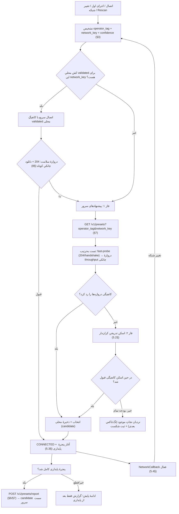

# طراحی ۰۰۰۱ — کشف شبکه، اعتبارسنجی اشتراکی کانفیگ، و اینترفیس جدا برای اسکن/مسیر داخلی

- وضعیت: **تصمیم‌ها قفل شد (۲۰۲۶-۱۱-۱۷) — آمادهٔ کد، منتظر چراغ سبز کاربر برای گام ۱**
- تاریخ: ۲۰۲۶-۱۱-۱۷
- جایگزین/اصلاح‌کنندهٔ: بخش‌هایی از [client-auto-tuning-spec.md](../integration/client-auto-tuning-spec.md) (§۳، §۴.۱، §۶.۱) و [ADR-0007](../decisions/0007-client-auto-tuning-and-isp-presets.md)
- مرتبط با: [ADR-0005](../decisions/0005-client-core.md)، [ADR-0006](../decisions/0006-resilient-transports-and-anti-throttling.md)، [protocol-contract.md](../integration/protocol-contract.md)، [client-coordination.md](../integration/client-coordination.md)، [roadmap-core.md](../roadmap-core.md) فاز ۹

> این سند «منطق» را قبل از کد محکم می‌کند و ایراداتش را صریح بیرون می‌کشد. طبق دستور کاربر:
> اول منطق → ایرادیابی → داکیومنت → بعد کد. هیچ پیاده‌سازی‌ای تا تأیید این سند شروع نمی‌شود.

---

## ۰) خواستهٔ کاربر (عیناً، به‌عنوان قرارداد طراحی)

1. دیالوگ تبلیغاتی/احساسی نمی‌خواهیم. رشتهٔ «در حال بررسی نوع خط شما و کشف بهترین مسیر خروج...» **ممنوع**. در نهایت فقط بنویسد **scanning** و اطلاعاتی که راجع‌به اپراتور/سیم‌کارت/مسیر پیدا می‌کند.
2. هر اپراتور یک **تگ ثابت** دارد: شاتل موبایل، مخابرات ثابت، همراه اول، ایرانسل، سامانتل، پیشگامان ثابت، شاتل ثابت، آسیاتک ثابت و…
3. هر تگ اپراتور **زیرمجموعهٔ کانفیگ** دارد؛ چون یک کانفیگ ممکن است در یک منطقه کار کند و در جای دیگر کند/وصل‌نشده باشد.
4. **منطقه‌محورِ هاردکد نمی‌خواهیم.** کلاینت خودش بهترین کانفیگ را برای منطقه/پرووایدر/سیم‌کارت خودش پیدا می‌کند؛ وقتی به شرایط **پایدار** رسید آن را به سرور **گزارش** می‌کند تا **معتبر** شود و به بقیهٔ کلاینت‌های همان نت ارائه شود. پس اسکن کامل برای همه الزامی نیست.
5. **دو فازی:** اول کانفیگ‌های پیشنهادیِ اپراتور از سرور گرفته و تست می‌شود؛ اگر خوب نبود، کلاینت **ذره‌ذره** خودش اسکن می‌کند تا به نتیجه برسد.
6. **کنار تونل یک اینترفیس شبکهٔ جدا** لازم است تا کلاینت بتواند حتی وقتی VPN وصل است، نت ایران را اسکن کند؛ و **سایت‌های داخلی از اینترفیس ایران** رد شوند، نه از سرور VPN.

این سند هر شش مورد را پیاده می‌کند و در §۱۲ ایرادات نسخهٔ ساده‌لوحانهٔ همین ایده و اسناد قبلی را فهرست می‌کند.

---

## ۱) تفکیک کلیدی: «تگ هویت» ثابت است، «پارامتر اتصال» هرگز هاردکد نمی‌شود

تنش ظاهری بین «تگ ثابت اپراتور» (خواستهٔ ۲) و «نفی هاردکد / منطقه‌محور نبودن» (ADR-0007 اصل ۱ و خواستهٔ ۴) این‌گونه حل می‌شود:

- **operator_tag یک برچسبِ هویت است، نه یک تنظیم.** فهرست ثابتِ نام اپراتورها مجاز است؛ این‌ها فقط «ما روی کدام نت هستیم» را نام‌گذاری می‌کنند.
- **آن‌چه هرگز هاردکد نمی‌شود، نگاشتِ «اپراتور → پارامتر اتصال» است.** هیچ جدولِ «برای همراه اول حتماً fragment=100-200 و mtu=1280» وجود ندارد. این دقیقاً همان جدولِ §۳ سند قبلی است که در §۱۳ به «فرضیهٔ اولیه/seed» تنزل می‌یابد.
- **زیرمجموعهٔ کانفیگ (config sub-tag) از داده زاده می‌شود، نه از پیش‌تعریف per-region.** یک ردیف اعتبارسنجی به کلید `(operator_tag, network_key, config_id)` ساخته می‌شود وقتی کلاینت‌های واقعی روی همان نت آن کانفیگ را پایدار اندازه بگیرند. «منطقه» به‌صورت یک جزءِ *کشف‌شده* در `network_key` می‌آید، نه یک قاعدهٔ دستی.

نتیجه: دو کاربرِ همراه اول در دو منطقه، دو `network_key` متفاوت دارند → دو ردیف اعتبارسنجی مستقل → کانفیگِ خوبِ یکی به‌زور به دیگری تحمیل نمی‌شود. این همان خواستهٔ ۳ و ۴ است بدون هیچ هاردکدِ منطقه‌ای.

---

## ۲) مدل داده (واژه‌ها و کلیدها)

### ۲.۱. operator_tag — فهرست ثابتِ هویت (قابل‌گسترش توسط ادمین، نه توسط کد)

| operator_tag | نوع | نمونهٔ شناسهٔ تشخیص |
| :--- | :--- | :--- |
| `mci` (همراه اول) | cellular | MCC=432, MNC=11 |
| `irancell` (ایرانسل) | cellular | MCC=432, MNC=35 |
| `rightel` (رایتل) | cellular | MCC=432, MNC=20 |
| `shatel_mobile` (شاتل موبایل) | cellular/MVNO | MNC میزبان + نگاشت MVNO |
| `samantel` (سامانتل) | cellular/MVNO | MNC میزبان + نگاشت MVNO |
| `mokhaberat_fixed` (مخابرات ثابت) | fixed | ASN/ISP از IP عمومی |
| `shatel_fixed` (شاتل ثابت) | fixed | ASN/ISP از IP عمومی |
| `pishgaman_fixed` (پیشگامان ثابت) | fixed | ASN/ISP از IP عمومی |
| `asiatech_fixed` (آسیاتک ثابت) | fixed | ASN/ISP از IP عمومی |
| `zitel` (زیتل) | fixed | ASN/ISP |
| `unknown` | هر | وقتی تشخیص قطعی نیست |

- این فهرست **داده** است (در پنل/سرور نگهداری و قابل‌افزودن)، نه `when`ِ هاردکد در اپ. افزودن اپراتور جدید نباید نیاز به بیلد جدید اپ داشته باشد.
- نگاشت `MNC → operator_tag` باید **MVNOها را بشناسد** (سامانتل/شاتل موبایل روی MNC میزبان سوار می‌شوند؛ §۱۲ ایراد ۵).
- برای خطوط ثابت، operator_tag از **ASN/ISPِ IP عمومی** می‌آید، **نه از SSID** (§۱۲ ایراد ۴).

### ۲.۲. network_key — اثرانگشتِ حریم‌محورِ «همان نت»

کلیدی که تعیین می‌کند کدام کلاینت‌ها «روی همان نت» هستند و می‌توانند کانفیگ معتبر را به اشتراک بگذارند.

**تصمیم نهایی (بررسی‌شده، ۲۰۲۶-۱۱-۱۷): دانه‌بندی بر حسب نوع شبکه فرق می‌کند — یک اندازه برای همه غلط است.**

- **ثابت/وای‌فای:** `f.<asn>.<prefix24>` — یعنی همان `/24` (سه اکتت). برای خط ثابت `/24` **پایدار** است (IP خانه به‌ندرت عوض می‌شود) و ISP آن را **per-region** تخصیص می‌دهد؛ پس `/24` خودش منطقه را در بر دارد. افزودنِ کد استان روی آن **زائد** است و فقط نمونه‌ها را تکه‌تکه می‌کند. این با قراردادِ موجودِ `/internal/reachability` (جدول `reachability_reports.network`) هم‌راستاست.
- **سلولار:** `c.<mcc>.<mnc>.<province>` — یعنی **استانِ درشت**، نه `/24`. دلیل: IP عمومیِ موبایل پشت **CGNAT** و استخرِ per-PGW/منطقه است و با جابه‌جایی کاربر **عوض می‌شود**؛ اگر `/24` بگذاریم، همان کاربر با رفتن به شهر دیگر `network_key` جدید می‌گیرد → کشِ validated‌اش را از دست می‌دهد و نمونه‌ها آن‌قدر پراکنده می‌شوند که هیچ‌وقت به K=3 نمی‌رسند. **استان** واحدِ درشتِ *پایدار* است که هم تهران را از مشهد جدا می‌کند (خواستهٔ ۳) و هم نمونه‌ها را روی هم جمع می‌کند.
- `province`: از ژئویِ درشتِ IP عمومی (`/24` → استان، مثلاً GeoLite2 City در سطح region) استنتاج می‌شود — **کشف‌شده، نه هاردکد، نه GPS دقیق**. اگر نامعلوم بود `unk`.
- **SSID خام هرگز به سرور نمی‌رود.** هشِ نمک‌دارِ SSID فقط **محلی** برای «آیا روی همان وای‌فای قبلی هستم» (کش/ابطال کش) است. اشتراکِ بین‌کاربری روی `asn + /24` (ثابت) یا `mcc/mnc + province` (سلولار) است، نه نامِ وای‌فایِ خانهٔ مردم.
- حریم: فقط MCC/MNC (اپراتور، نه شمارهٔ مشترک)، `/24` (مطابق قرارداد موجود)، و استانِ درشت. هیچ IMSI/شماره/موقعیت دقیق.

> **پالایشِ داده‌محور (نه هاردکد):** اگر یک `network_key` نتایج **دوقطبی/ناهمگن** نشان دهد (واریانسِ بالای death_rate/throughput بین کلاینت‌ها = بعضی عالی، بعضی مرده)، سرور آن را «too coarse» علامت می‌زند و می‌تواند **خودکار** ریزتر کند (مثلاً استانِ سلولار → خوشه‌های `/24`). این‌طور دانه‌بندی از داده زاده می‌شود، نه از پیش‌تعریفِ منطقه‌ای. پاسخِ مستقیم به خواستهٔ ۳ و ایراد ۲۱.

### ۲.۳. config_id — هویتِ «شکلِ پارامتر»، نه هویتِ کاربر

- `config_id = sha256(canonical(connection_params))[:16]`
- `connection_params` شامل: engine (`xray`/`hysteria`/`awg`)، transport، endpoint/box، port یا port_range، sni، fingerprint، fragment{packets,length,interval}، mtu، obfs، پارامترهای AWG (jc/jmin/jmax/s1/s2)، clean_ip.
- **شاملِ هیچ secretِ کاربر نیست.** رمز/uuid هر کاربر جداگانه از `GET /v1/client/xray?tag=` می‌آید. preset فقط «شکل» را می‌دهد؛ کلاینت آن را با اعتبارنامهٔ خودش ترکیب می‌کند (§۱۲ ایراد ۱۸).
- کانفیگ‌های یکسانِ کاربران مختلف → یک `config_id` → dedupe خودکار (جلوگیری از انفجار تگ، §۱۲ ایراد ۸).

### ۲.۴. ردیف اعتبارسنجی (server) — همان «زیرمجموعهٔ کانفیگ»

```
validation_row {
  operator_tag,
  network_key,
  config_id,
  status:        candidate | validated | retired,
  samples:       n,            // تعداد اندازه‌گیری
  clients:       k,            // تعداد کلاینت مستقل (uid متمایز)
  p50_latency_ms,
  p50_throughput_kbps,         // حتماً رِنج‌محور/چانکی، نه 204
  death_rate,                  // کسر دورهای مرده
  first_seen, last_seen,
  confidence,                  // وزن اعتبار (§۶)
  server_corroborated: bool,   // آیا بایتِ واقعیِ inbound آن را تأیید می‌کند (§۶.۳)
  source:        crowd | admin // admin = override دستیِ ادمین (§۷.۴)، audited
}
```

چرخهٔ عمر: `candidate` (گزارشِ اولیه) → `validated` (آستانه‌های §۶.۲ + تأیید سمت سرور) → `retired` (زوالِ تازگی یا تناقضِ اندازه‌گیری). این چرخه باعث می‌شود کانفیگِ ماهِ پیش که امروز مرده، خودش از رده خارج شود (§۱۲ ایراد ۱۹).

---

## ۳) تشخیص شبکه و اپراتور (صادقانه، با confidence)

ترتیب تشخیص:

1. **نوع شبکه:** از `ConnectivityManager.NetworkCapabilities` → `TRANSPORT_CELLULAR` یا `TRANSPORT_WIFI`.
2. **سلولار:** `TelephonyManager` → MCC/MNC (سیم فعال؛ در Dual-SIM هر دو خوانده و سیمِ دیتایِ فعال ملاک است). نگاشت MNC→operator_tag با جدول MVNO. اگر رومینگ/نامشخص → `unknown` + تکیه بر IP-ISP.
3. **ثابت/وای‌فای:** IP عمومی (از یک echo endpoint روی **مسیر محافظت‌شده**، §۴) → ASN/ISP → operator_tag. SSID فقط برای network_key محلی.
4. **region_code:** ژئویِ درشتِ `/24` (سمت سرور یا DB محلی). اگر در دسترس نبود `unk`.
5. **confidence:** هر تشخیص یک سطح اطمینان دارد (`high`/`medium`/`low`). در UI نشان داده می‌شود (§۹). اگر `low`، به‌جای ادعای قطعی، تگ `unknown` و تکیه بر `network_key`.

**چه‌چیز را روی «اینترفیس جدا» می‌سنجیم (§۴):** هویت اپراتور، کیفیت خطِ زیرین (تأخیر/لاست به لنگرهای داخلی)، Path MTU، و دسترس‌پذیریِ endpointهای خارجیِ ما از خطِ فیزیکی. این‌ها بدون رفتن به داخل تونل اندازه گرفته می‌شوند تا تونلِ فعال disturb نشود و عددِ واقعیِ خط به‌دست آید.

---

## ۴) اینترفیس جدا + مسیر داخلی (split-tunnel) — دقیق و صادقانه

### ۴.۱. واقعیتِ پلتفرم: «اینترفیس دوم» یک NIC جادویی نیست

اندروید به ما کارت شبکهٔ دوم نمی‌دهد. آن‌چه داریم:

- `VpnService.protect(fd)` → سوکت را از TUN بیرون می‌برد تا روی **شبکهٔ فیزیکیِ زیرین** برود (جلوگیری از لوپ؛ قبلاً در client-coordination §۳ برای «استثنا کردن سرور» توافق شده).
- `ConnectivityManager.bindProcessToNetwork(physicalNetwork)` یا `physicalNetwork.openConnection()` / `socketFactory` → سوکتِ مشخص را به شبکهٔ فیزیکی مقید می‌کند.
- در ویندوز/لینوکس: روت استاتیکِ مقصدِ داخلی/سرور از طریق گیت‌ویِ فیزیکی (مطابق جدول client-coordination §۳).

پس «اینترفیس جدا برای اسکن و مسیر داخلی» = **مسیرِ فیزیکیِ محافظت‌شده**، موازی با TUN. این را صادقانه در سند می‌آوریم تا تیم موبایل دنبال NIC دوم نگردد.

### ۴.۲. سه کلاس سوکت (تفکیک حیاتی)

| کلاس | مسیر | چرا |
| :--- | :--- | :--- |
| **دیتاپلین تونل** | TUN → هسته → سرور خارجی | ترافیک عادیِ کاربر |
| **پروب/کنترل به سرورِ خارجیِ ما** | `protect()` → فیزیکی | نباید داخل تونل لوپ بخورد؛ باید خطِ واقعی را بسنجد؛ bootstrap/login/presets/report از این مسیر |
| **مقصدِ داخلی (ایرانی)** | `protect()` → فیزیکی | سایت ایرانی نباید از خروجِ آلمان/ترکیه برود (§۴.۴) |

نکته: پروب‌های اسکنِ کانفیگ به endpointهای **خارجیِ** ما می‌روند؛ «مسیر داخلی» شامل آن‌ها نمی‌شود. `protect()` برای آن‌ها فقط ضدلوپ و برای اندازه‌گیریِ خطِ زیرین است. تفکیک این دو در نسخهٔ ساده‌لوحانه گم می‌شود (§۱۲ ایراد ۱۱/۱۳).

### ۴.۳. دسته‌بندی مقصد داخلی و chicken-and-eggِ DNS

برای این‌که بفهمیم یک مقصد «داخلی» است:

1. **مسیر سریعِ پسوند + GeoIP (تصمیم نهایی کاربر: فعلاً همین کافی است):** پسوند `.ir` به‌علاوهٔ GeoIPِ IPِ resolve‌شده (محدوده‌ها/ASNهای ایرانی). این فهرست **داخلی/built-in** است؛ فهرستِ دامنهٔ سمت سرور **فعلاً لازم نیست** (بعداً اگر خواستیم، ادمین می‌تواند از §۷.۴ گسترش دهد).
2. **GeoIPِ IPِ resolve‌شده:** اگر IP در محدوده‌ها/ASNهای ایرانی بود → داخلی.
3. **ترتیبِ resolve→classify→route:** اول IP را بگیر، بعد دسته‌بندی کن، بعد مسیر بده. resolverِ مورد استفاده برای classification خودش باید امن باشد (یک resolverِ بی‌طرف روی مسیر محافظت‌شده، یا فهرستِ دامنهٔ سمت سرور که ابهامِ resolve را حذف می‌کند).
4. **fail-closed:** اگر دسته‌بندی نامعلوم/مشکوک بود → **داخل تونل بمان** (نه bypass). این جلوی نشتِ ترافیک خارجی از مسیر داخلی را می‌گیرد (§۱۲ ایراد ۱۳).

### ۴.۴. چرا اصلاً مسیر داخلی لازم است (دلیل واقعی، فراتر از تأخیر)

- **سایت‌های ایرانی اغلب IP خارجی را بلاک می‌کنند** (تحریمِ معکوس/ژئوبلاک). اگر ترافیکِ سایتِ ایرانی از خروجِ آلمان/ترکیه برود، ممکن است اصلاً باز نشود. پس bypass داخلی یک **الزامِ کارکردی** است، نه فقط بهینه‌سازی تأخیر.
- تأخیر/پهنای باندِ داخلی هم بهتر است (موارد داخلی نباید دورِ دنیا بزنند).

### ۴.۵. کران‌های DNS و IPv6 (جلوگیری از نشتیِ جدید)

- **دامنه‌های داخلی:** resolve از resolverِ مسیرِ فیزیکی (یک نشتیِ *کنترل‌شده و محدود* به resolver داخلی). این عمدی است تا جوابِ CDNِ داخلی درست بیاید.
- **دامنه‌های خارجی:** فقط DoH داخل تونل (مطابق قاعدهٔ ثابت roadmap). هیچ resolver مستقیمِ خارجی.
- **IPv6:** روی هر دو مسیر **fail-closed**. مسیر داخلی نباید بهانه‌ای برای نشتِ IPv6 خارجی شود.
- **تفکیک تحریم:** فقط مقصدِ *ایرانی* bypass می‌شود. میزبان‌های تحریمیِ خارجی همچنان از زنجیرهٔ خروجِ سمت سرور (geo-exit) می‌روند؛ کلاینت کاری نمی‌کند (protocol-contract §۲). bypass داخلی هرگز نباید مسیرِ geo-exit را دور بزند.

### ۴.۶. شکستِ protect() / نبودِ شبکهٔ فیزیکی

اگر `protect()` شکست خورد، یا شبکهٔ فیزیکی نبود (حالت پرواز، captive portal، تونل تنها مسیر):

- تشخیص بده و **blackhole نکن**. سوکتِ داخلیِ شکست‌خورده → fallback به تونل به‌عنوان آخرین چاره (با ثبت این‌که بعضی سایت‌های داخلی ممکن است روی IP خارجی بلاک شوند).
- captive portal: تا وقتی پورتال باز نشده، اسکن/پروب داخلی را متوقف کن (عددِ غلط نده).
- این حالت‌ها باید در UI به‌صورت واقع‌بینانه («مسیر داخلی در دسترس نیست») بیایند، نه ادعای موفقیت.

---

## ۵) جریان دو-فازی کشف (خواستهٔ ۵)



### ۵.۱. فاز ۱ — پیشنهادهای سرور، ارزان و سریع

- `GET /v1/presets` کانفیگ‌های **validatedِ همان network_key** را اول، بعد validatedِ سطح اپراتور، و در آخر **seedِ فرضیه‌ای** (با برچسبِ صریحِ «اعتبارسنجی‌نشده») برمی‌گرداند (§۶.۴).
- کلاینت به‌ترتیب تست می‌کند: اول **fast-probe** (204/handshake) برای حذفِ سریعِ مرده‌ها، بعد **دروازهٔ throughput** (§۸) برای صلاحیت. فقط 204 کافی نیست (§۱۲ ایراد ۱).
- اولین کانفیگی که هر دو دروازه را رد کند → اتصال. **اسکن کامل برای این کاربر لازم نیست** (خواستهٔ ۴).

### ۵.۲. فاز ۲ — اسکن تدریجیِ کران‌دار («ذره‌ذره»)

اگر هیچ پیشنهادی قبول نشد:

- **تدریجی، یک بُعد در هر مرحله:** fragment{length,interval} → port/port_range → mtu → clean_ip/CDN. نه کل ماتریس یک‌جا.
- **کران‌دار:** سقفِ زمان/تعداد پروب/بایت per-session؛ **قابل‌وقفه و ازسرگیری‌پذیر**؛ cooldown بین دورها.
- **توقف زودهنگام:** به‌محض این‌که یک کانفیگ دروازهٔ throughput+پایداری را رد کرد، اسکن قطع می‌شود.
- **آگاه از باتری/دیتا:** روی دیتایِ metered/باتریِ کم، سقف سخت‌گیرانه‌تر؛ اسکنِ سنگین فقط با Rescanِ صریح کاربر یا شکستِ کامل پیشنهادها.
- ابعاد و بازه‌های نمونه از ADR-0007 §۳ می‌آیند (fragment سه‌بازه، پورت‌های 443/8443/2053 + تصادفی، MTU [1200,1280,1350]، clean IP). این‌ها **فضای جستجو** هستند، نه مقدارِ ثابتِ نهایی.

### ۵.۳. پنجرهٔ پایداری قبل از گزارش (خواستهٔ ۴: «وقتی مطمئن شد»)

یک کانفیگ فقط وقتی «پایدار» است که:

- دروازهٔ throughput چانکی را رد کرده باشد (§۸)، **و**
- برای `≥ T_stable` دقیقه متصل مانده باشد (پیشنهاد: ۳–۵ دقیقه)، **و**
- `death_rate ≤ D` در چند چرخهٔ reconnect/پایش (پیشنهاد: ۰ از ۳ دورِ پایش)، **و**
- تأخیر/throughput در طول پنجره فرو نریخته باشد.

**گزارش فقط بعد از این پنجره** ارسال می‌شود، نه بعد از یک 204ِ تنها. این جلوی گزارشِ fluke را می‌گیرد (§۱۲ ایراد ۱۷).

### ۵.۴. ردیابی تغییر شبکه

`ConnectivityManager.NetworkCallback` (مطابق spec §۵ و ADR-0007 اصل ۴): تغییر WiFi↔Cellular، سوییچ سیم ۱/۲، تغییر operator/network_key → بارگذاری سریع validatedِ محلیِ همان نت، و اگر نبود فاز ۱. شنونده باید debounce شود تا روی نوسانِ لحظه‌ای هی اسکن راه نیندازد.

---

## ۶) اعتبارسنجی سمت سرور و اشتراک با همتایان (قلبِ خواستهٔ ۴)

### ۶.۱. گزارشِ کلاینت (necessary but not sufficient)

`POST /v1/presets/report` (§۷.۲) شامل نمونه‌های اندازه‌گیری + پنجرهٔ پایداری + روشِ پروب. سرور گزارش‌هایی را که **روشِ معتبر ندارند** (مثلاً فقط 204، بدون throughput چانکی) برای ارتقا به validated **نمی‌پذیرد**.

### ۶.۲. آستانه‌های ارتقا candidate → validated (تصمیم نهایی: پیش‌فرض‌های زیر، **قابل‌تنظیم در پنل**، نه هاردکد)

- `k ≥ K` کلاینتِ **مستقل** (uid متمایز روی همان network_key) — **K=3**.
- `n ≥ N` نمونه — **N=6**.
- `p50_throughput_kbps ≥ T` (چانکی) — **T=500KB/s** (مطابق client-coordination §۵.۳).
- `death_rate ≤ D` — **D=0.1** (حداکثر ۱ شکست در ۱۰ دور).
- تازگی: `last_seen` در `R` روز گذشته — **R=14**.
- **میانه (median) نه میانگین**؛ حذفِ outlier با MAD. یک کلاینتِ پرت نمی‌تواند یک کانفیگِ بد را validated کند.

> **معنی سادهٔ این اعداد (برای کاربر):** K=3 یعنی «حداقل ۳ کاربرِ *متفاوت* روی همان نت باید یک کانفیگ را تأیید کنند تا آن را برای *همه* معتبر اعلام کنیم» — تا شانس/خطای یک نفر برای بقیه تصمیم نگیرد. N=6 یعنی «حداقل ۶ بار اندازه‌گیری» تا میانه پایدار شود. T=500KB/s یعنی «کانفیگ باید واقعاً ~۰.۵ مگابایت بر ثانیه دانلود کند» (کفِ *قابل‌استفاده* از اندازه‌گیری v1، نه سرعتِ عالی). D=0.1 یعنی «از هر ۱۰ تست حداکثر ۱ بار مرده». R=14 یعنی «اعتبار بعد از ۱۴ روز بدون تأییدِ تازه منقضی می‌شود» چون فیلترینگ ایران عوض می‌شود.

> **رفعِ نگرانیِ cold-start (مهم):** K=3 فقط دروازهٔ **اشتراک با دیگران** است، **نه** دروازهٔ نفعِ خودِ کاربر. هر کلاینت بهترین کانفیگِ *خودش* را **محلی** کش می‌کند (§۵ مسیر C→D)؛ پس یک کاربرِ تنها روی یک نتِ کمیاب هم دفعهٔ بعد بدون اسکنِ کامل وصل می‌شود، حتی اگر سرور هرگز به K=3 نرسد. ردیفِ سرور تا رسیدن به K حداکثر `candidate` می‌ماند و به‌عنوان validated به بقیه داده نمی‌شود.

### ۶.۳. تأییدِ متقابل با بایتِ واقعیِ سرور (ضدِ بازی‌خوردن)

- سرور از تلمتری فاز ۵ (بایت/مرگِ هر درب per-/24) **مستقلاً** می‌بیند که آیا این config_id روی این network_key واقعاً ترافیکِ موفق دارد.
- `server_corroborated` وقتی true می‌شود که بایتِ inboundِ مشاهده‌شده با ادعای کلاینت هم‌خوان باشد. گزارشِ کلاینتِ تنها، بدونِ corroboration، حداکثر `candidate` می‌ماند.
- این دفاع در برابر کلاینتِ مخرب/باگی است که throughputِ دروغین گزارش می‌کند (§۱۲ ایراد ۷).

### ۶.۴. ارائه به همتایان

`GET /v1/presets` به‌ترتیب برمی‌گرداند:

1. `validated`ِ همان `network_key` (بالاترین confidence، تازه‌ترین).
2. `validated`ِ سطح `operator_tag` (وقتی network_key دقیق هنوز ردیف ندارد).
3. `seed`ِ فرضیه‌ای (پایین‌ترین اولویت، **با برچسبِ صریحِ unvalidated**).

کلاینت به همین ترتیب تست می‌کند. پس اکثر کاربران هرگز به فاز ۲ نمی‌رسند (خواستهٔ ۴: اسکن کامل الزامی نیست).

### ۶.۵. زوال و بازنشستگی

- ردیفِ validated با `last_seen > R` → `candidate` (نیاز به تأیید مجدد).
- تناقضِ اندازه‌گیریِ تازه (death_rate بالا / throughput پایین) یا contradictِ بایتِ سرور → `retired`.
- seedها هرگز به‌تنهایی validated نمی‌شوند؛ فقط دادهٔ واقعی ارتقا می‌دهد.

---

## ۷) قرارداد API (هم‌راستا با protocol-contract.md)

### ۷.۱. `GET /v1/presets`

درخواست:
```http
GET /v1/presets?operator_tag=mci&network_key=c.432.11.teh&network_type=cellular HTTP/1.1
Authorization: Bearer <token>
X-Client-Platform: android
X-Client-Version: 67
```

پاسخ (نمونهٔ اسکلت — مقادیرِ پارامتر **فرضیه/داده** هستند، نه هاردکد):
```json
{
  "operator_tag": "mci",
  "network_key": "c.432.11.teh",
  "generated_at": "2026-11-17T12:00:00Z",
  "candidates": [
    {
      "priority": 1,
      "config_id": "a1b2c3d4e5f60718",
      "status": "validated",
      "confidence": 0.82,
      "clients": 5,
      "p50_throughput_kbps": 900,
      "engine": "xray",
      "transport": "reality",
      "params": { "port": 443, "sni": "www.microsoft.com", "fingerprint": "chrome",
                  "fragment": {"packets":"1-3","length":"100-200","interval":"10-20"}, "mtu": 1280 }
    },
    {
      "priority": 9,
      "config_id": "seed-reality-01",
      "status": "seed",
      "confidence": 0.0,
      "engine": "xray",
      "transport": "reality",
      "params": { "...": "فرضیهٔ اولیه، اعتبارسنجی‌نشده" }
    }
  ]
}
```
- `params` فقط **شکلِ پارامتر** است؛ secretِ کاربر نیست. پروفایلِ دارای اعتبارنامه از `GET /v1/client/xray?tag=` می‌آید و کلاینت config_id را با آن ترکیب می‌کند.
- سرور فقط ترانسپورت‌های **سنجیده‌زنده** را در presets می‌گذارد؛ inboundِ مرده (مثل ss-2022 با `users[]`) هرگز پیشنهاد نمی‌شود (§۱۲ ایراد ۱۶).

### ۷.۲. `POST /v1/presets/report` (جدید)

```json
{
  "operator_tag": "mci",
  "network_key": "c.432.11.teh",
  "config_id": "a1b2c3d4e5f60718",
  "platform": "android",
  "client_version": 67,
  "probe_method": "range-512k",
  "samples": [
    {"latency_ms": 180, "throughput_kbps": 950, "bytes": 2097152, "duration_s": 2.2, "verdict": "ok", "ts": "2026-11-17T12:01:00Z"}
  ],
  "stability": {"connected_minutes": 4.5, "reconnects": 0, "deaths": 0}
}
```
- احراز هویت با توکن؛ **rate-limit** per-uid؛ ردِ گزارشِ بدونِ `probe_method` معتبر یا بدونِ نمونهٔ throughput.
- این endpoint مکملِ `/internal/reachability` است (آن verdictِ per-/24 می‌دهد؛ این اندازه‌گیریِ per-config برای اعتبارسنجی).

### ۷.۳. `GET /v1/operators` (تصمیم نهایی: لازم)

فهرستِ operator_tagها + نگاشت MNC/ASN (شامل MVNOها) + فهرستِ دامنهٔ داخلیِ built-in (§۴.۳). تا اپ برای افزودن اپراتور نیاز به بیلد جدید نداشته باشد و تشخیصِ MVNO (§۳) داده‌محور بماند.

### ۷.۴. مسیرهای ادمین (override دستی — تصمیم نهایی کاربر: **بله**)

همه با توکنِ نقشِ `admin`، ثبتِ audit (چه‌کسی/کی/چه‌چیز)، و `source=admin` روی ردیف:

- `POST /v1/admin/operators` — افزودن/ویرایش operator_tag + نگاشت MNC/ASN (گسترشِ فهرستِ «و…»).
- `POST /v1/admin/presets/validate` — ارتقای دستی یک `(operator_tag, network_key, config_id)` به `validated` (override؛ آستانه‌های K/N را دور می‌زند چون ادمین موردِ اعتماد است، ولی **audit می‌شود** و همچنان تابعِ زوالِ R است).
- `POST /v1/admin/presets/retire` — بازنشستگیِ دستی یک کانفیگ (مثلاً وقتی ادمین می‌داند یک درب مرده).
- `POST /v1/admin/presets/seed` — پین/افزودنِ seedِ فرضیه‌ای (اولویت پایین، unvalidated).
- `POST /v1/admin/domestic` — گسترشِ فهرستِ دامنهٔ داخلی (اختیاری، برای بعد از `.ir + GeoIP`).

> override ادمین **مکملِ** کشفِ خودکار است، نه جایگزین: ردیفِ `source=admin` در کنارِ `source=crowd` می‌ماند و اگر دادهٔ واقعیِ بعدی آن را contradict کند، سرور می‌تواند آن را به `retired` برگرداند (با اطلاعِ ادمین). این جلوی «overrideِ فراموش‌شدهٔ غلط» را می‌گیرد.

---

## ۸) دروازه‌ها و امتیازدهی (اصلاحِ تلهٔ اندازه‌گیری)

**تلهٔ اندازه‌گیری‌شده (از v1):** کندکننده **per-flow** است؛ یک جریانِ بلندِ TCP بعد از ~۲–۳MB خفه می‌شود (۷.۷–۵۵KB/s)، درحالی‌که چانک‌های رِنجیِ ۵۱۲KiB هرکدام ۰.۶–۱.۹MB/s می‌روند. پس:

- **fast-probe (204/handshake)** فقط برای *حذفِ سریعِ مرده‌ها* است — ارزان، ولی **هرگز معیارِ صلاحیت نیست**. spec قبلی §۴.۱ می‌گفت «زیر ۴۰۰ms با 204 → فوراً وصل شو»؛ این دقیقاً همان تله است (§۱۲ ایراد ۱).
- **دروازهٔ throughput (اجباری برای صلاحیت):** دانلودِ چانکیِ رِنج‌محور (پیشنهاد: ۲MiB در چانک‌های ۵۱۲KiB برای اسکن؛ ۸MiB برای پذیرشِ نهایی مطابق client-coordination §۵.۳). میانگین ≥ آستانه (پیشنهاد ۵۰۰KB/s) و بدونِ فروپاشیِ چانک‌های آخر.
- **امتیازدهی (اصلاح‌شده):** به‌جای `1000/latency × success × throughputWeight` که latency را غالب می‌کند، امتیاز باید **throughput-پایدار-محور** باشد و latency فقط tie-breaker:

```
eligible = (fast_probe_ok) AND (chunked_throughput >= T) AND (death_rate <= D)
score    = p50_chunked_throughput_kbps            // محور اصلی
           × stability_factor(connected_minutes, deaths)
           × recency_factor(last_seen)
tie_break: lower p50_latency_ms
```

- کانفیگی که 204 را در ۱۵۰ms رد می‌کند ولی در چانکِ سوم به ۳۰KB/s می‌رسد، **eligible نیست**. این همان درسی است که RATE-1 و UPDATE-CHUNK در v1 به ما دادند.

---

## ۹) رابط کاربری (خواستهٔ ۱ — فقط scanning + واقعیت‌های کشف‌شده)

### ۹.۱. قاعدهٔ سخت

- در حال کشف: یک کلمهٔ وضعیت **«scanning»** (یا «اسکن»). **هیچ رشتهٔ تبلیغاتی/احساسی.**
- رشته‌های **ممنوع** (عیناً): «در حال بررسی نوع خط شما و کشف بهترین مسیر خروج...»، «در حال آنالیز وضعیت شبکه و تست بهترین راهکارهای اتصال برای خط شما...»، «بهترین مسیر برای خط همراه اول شما انتخاب شد».
- به‌جای آن، **کارتِ واقعیت‌های کشف‌شده** با تگ:

```
scanning
─────────────
اپراتور:   همراه اول            (confidence: high)
سیم:       MCC 432 / MNC 11
شبکه:      cellular · region: teh
مسیر:      xray/reality · port 443
تأخیر:     180 ms
throughput: 950 KB/s (چانکی)
پایداری:   4.5 min · 0 مرگ
```

- وقتی وصل شد: وضعیت **«connected»** + همان کارتِ واقعیت (به‌روزرسانی زندهٔ تأخیر/throughput).
- دکمهٔ اسکن مجدد: برچسبِ سادهٔ **«اسکن مجدد»** (نه «بهینه‌سازی و اسکن مجدد شبکه» که لحنِ تبلیغاتی دارد؛ spec §۶.۲ اصلاح می‌شود).
- اگر تشخیص `low` بود: تگ `unknown` و confidence نمایش داده شود؛ **ادعای قطعی نکن**.
- اگر مسیر داخلی در دسترس نبود (§۴.۶): واقع‌بینانه بنویس، نه «بهترین مسیر انتخاب شد».

### ۹.۲. صداقتِ UI

UI فقط آن‌چه را **اندازه گرفته‌ایم** نشان می‌دهد. «بهترین» یک ادعای نسبی است که فقط وقتی معنا دارد که چند کانفیگ را مقایسه کرده باشیم؛ در غیر این‌صورت فقط «کانفیگِ فعال + اعدادش». این با خواستهٔ ۱ (فقط scanning + اطلاعات کشف‌شده) هم‌راستاست.

---

## ۱۰) داوری با نردبان و مالکیتِ هسته (جلوگیری از دو-سوئیچرِ جنگنده)

کلاینتِ فعلی یک **نردبان نجات** + **سوئیچر واکنشی** (آستانهٔ ۲۰٪ تأخیر، cooldown ۵ دقیقه) + **rung-memory** دارد. اگر موتور کشف **مستقلاً** هم بخواهد ترانسپورت/هسته را عوض کند، دو سوئیچر با هم می‌جنگند (§۱۲ ایراد ۱۰/۲۰).

**قاعدهٔ مالکیتِ واحد:**

- **ماشینِ حالتِ اتصال** (نردبان/rung-memory) **تنها مالکِ «کدام کانفیگ فعال است»** است.
- **موتور کشف** فقط **مشاور و اندازه‌گیر** است: کانفیگ‌های ranked پیشنهاد می‌دهد، ردیف‌های validated محلی را به‌روز می‌کند، و **ترتیبِ پله‌های نردبان** را تغذیه می‌کند (validated اول).
- کشف هرگز خودش `startLoop/stopLoop` را برای سوییچ صدا نمی‌زند؛ نتیجه‌اش را به ماشینِ حالت می‌دهد و آن اعمال می‌کند.
- سوئیچر واکنشی و کشف باید cooldown/آستانهٔ مشترک داشته باشند تا double-switch نکنند.

این همان اصلِ «یک ترانسپورت در چرخش، بقیه در نردبان» (roadmap قاعدهٔ ثابت) را در سطحِ کشف حفظ می‌کند.

---

## ۱۱) بودجهٔ اسکن، حریم خصوصی، و امنیت

- **بودجه:** سقفِ per-session (زمان/پروب/بایت)، ازسرگیری‌پذیر، cooldown، فقط روی شکستِ پیشنهادها یا Rescan. روی metered/باتریِ کم سخت‌گیرانه‌تر. هدف: کاربرِ عادی هرگز اسکنِ کامل نبیند.
- **حریم:** network_key فقط MCC/MNC + /24 + region درشت. SSID خام/IMSI/شماره/GPS دقیق هرگز. هشِ نمک‌دارِ SSID فقط محلی. گزارشِ خودکار بعد از پایداری، ولی با کلیدِ حریم‌محور (پرسشِ باز §۱۴: رضایتِ کاربر؟).
- **امنیت:** سوکت‌های پروبِ محافظت‌شده با توکن احراز می‌شوند (نه open proxy). presets هیچ secretِ کاربرِ دیگر را ندارد. reportها authenticated + rate-limited + outlier-rejected + server-corroborated. دسته‌بندیِ داخلی fail-closed تا ترافیک خارجی از مسیر داخلی نشت نکند.

---

## ۱۲) ایرادات و ریسک‌ها (خواستهٔ کاربر: «ایراداتش رو دربیاریم»)

ایراداتِ نسخهٔ ساده‌لوحانهٔ ایده + اسناد قبلی، و اصلاحِ هرکدام در این سند:

1. **تلهٔ 204 (اندازه‌گیری‌شده):** spec §۴.۱ «204 زیر ۴۰۰ms → فوراً وصل» با per-flow shaping می‌میرد. → دروازهٔ throughput چانکی اجباری (§۸).
2. **جدولِ هاردکدِ §۳:** «برای MCI حتماً fragment=100-200/mtu=1280» نقضِ ADR-0007 اصل ۱ و خواستهٔ ۴ است. → seedِ فرضیه‌ای، نه قاعده؛ اعتبارسنجی داده‌محور (§۱، §۱۳).
3. **دیالوگِ تبلیغاتیِ §۶.۱:** نقضِ خواستهٔ ۱. → فقط scanning + واقعیت‌ها (§۹).
4. **SSID = اپراتور (غلط):** spec §۵ SSID را با اپراتور قاطی می‌کند. وای‌فایِ خانه روی Shatel هر SSIDی می‌تواند داشته باشد. → operator از MCC/MNC یا IP/ASN؛ SSID فقط network_key محلی (§۲.۲، §۳).
5. **شکافِ تشخیص MVNO/ثابت:** سامانتل/شاتل موبایل روی MNC میزبان سوارند؛ رومینگ/captive portal تشخیص را می‌شکند. → نگاشت MVNO + fallbackِ IP-ISP + confidence + `unknown` (§۲.۱، §۳).
6. **«همان نت» مبهم / پایداری انتقال‌ناپذیر:** دو کاربرِ MCI در دو شهر/سلول رفتار DPI متفاوت دارند. → network_key دانه‌درشت با regionِ کشف‌شده + اعتبارسنجیِ چندکلاینتی (§۲.۲، §۶).
7. **مسموم‌سازی/بازی‌خوردنِ report:** کلاینتِ مخرب/باگی throughput دروغ می‌دهد. → وزنِ اعتماد، حذفِ outlier (median+MAD)، کلاینتِ مستقل، **تأییدِ بایتِ سمت سرور**، auth+rate-limit (§۶.۲/۶.۳).
8. **انفجارِ تگ/زیرتگ:** operator × region × config می‌تواند منفجر شود. → config_id = هشِ محتوا (dedupe)، enumِ کران‌دار، region درشت، چرخهٔ retired (§۲.۳/۲.۴).
9. **بودجهٔ باتری/دیتا:** ماتریسِ کامل گران است. → اسکنِ تدریجیِ کران‌دار/ازسرگیری‌پذیر/cooldown، فقط روی شکست/Rescan (§۵.۲، §۱۱).
10. **مسابقهٔ مالکیتِ هسته با نردبان:** دو سوئیچر می‌جنگند. → کشف مشاور است؛ ماشینِ حالت تنها مالک (§۱۰).
11. **شکستِ protect() / نبودِ فیزیکی → blackhole:** حالت پرواز/captive portal. → تشخیص+fallback، توقفِ اسکن تا پورتال باز شود (§۴.۶).
12. **نشتیِ DNS/IPv6 از مسیر داخلی:** bypass داخلی می‌تواند resolver/IPv6 خارجی را نشت دهد. → resolver داخلیِ محدود برای دامنهٔ داخلی، DoH برای خارجی، IPv6 fail-closed (§۴.۵).
13. **chicken-eggِ دسته‌بندی + DNS poisoning:** برای فهمیدنِ داخلی‌بودن باید resolve کنی، ولی مسیرِ resolve به داخلی‌بودن بند است؛ IPِ مسموم می‌تواند خارجی را داخلی جا بزند. → resolve→classify→route با resolver بی‌طرف/فهرست سرور، **fail-closed: نامعلوم → تونل** (§۴.۳).
14. **سایتِ ایرانی IP خارجی را بلاک می‌کند + تفکیک تحریم:** دلیلِ واقعیِ bypass؛ و نباید geo-exit دور زده شود. → فقط مقصدِ ایرانی bypass؛ تحریمیِ خارجی همچنان geo-exit (§۴.۴/۴.۵).
15. **حریم:** SSID خام/IMSI/GPS دقیق. → کلیدِ حریم‌محور، هشِ نمک‌دارِ محلی، /24، region درشت (§۲.۲، §۱۱).
16. **کانفیگِ inboundِ مرده:** ss-2022 با `users[]` در ~۱۴ms رد می‌کند؛ نباید «کشف»/پیشنهاد شود. → سرور فقط ترانسپورتِ سنجیده‌زنده را در presets می‌گذارد (§۷.۱).
17. **تعریفِ پایداری (یک 204 ≠ پایدار):** گزارشِ fluke. → پنجرهٔ پایداری (دقیقه/reconnect/death) قبل از report (§۵.۳).
18. **presets حاملِ secret:** نباید اعتبارنامهٔ کاربرِ دیگر لو برود. → config_id فقط شکلِ پارامتر؛ اعتبارنامه از endpointِ احرازشده (§۲.۳، §۷.۱).
19. **تازگی/زوال:** کانفیگِ validatedِ ماهِ پیش امروز مرده. → TTL، بازنشستگی روی تناقض، re-validation (§۶.۵).
20. **تداخل با سوئیچر واکنشیِ موجود:** آستانهٔ ۲۰٪/cooldown ۵min نباید با کشف double-switch کند. → cooldown/آستانهٔ مشترک (§۱۰).
21. **regionِ درشت ممکن است هنوز برای سلولِ خاص کافی نباشد:** یک استان چند گیت‌وی DPI دارد. → اگر network_keyِ درشت validated نداد، فاز ۲ محلی جوابِ همان کاربر را پیدا می‌کند و ردیفِ خودش را می‌سازد؛ region را ریزتر نمی‌کنیم مگر داده نشان دهد لازم است (پرسشِ باز §۱۴).
22. **هزینهٔ echo/GeoIP روی مسیر داخلی:** تشخیص IP/ASN خودش یک probe است و روی خطِ فیلترشده ممکن است بلاک شود. → echo endpoint روی مسیر محافظت‌شده با fallback (bootstrap ladder)، و اگر نشد operator=`unknown` ولی network_key از /24ِ مشاهده‌شدهٔ سرور ساخته شود (§۳، §۴.۲).

---

## ۱۳) اصلاحِ اسناد قبلی (بدون حذف — «چیزی پاک نشه»)

مطابق قاعدهٔ ثابت کاربر، هیچ محتوایی حذف نمی‌شود؛ فقط **بنرِ اصلاح** اضافه و جایگاهش عوض می‌شود:

- **client-auto-tuning-spec.md §۳ (جدولِ تجربی per-operator):** بنر «این جدول **فرضیهٔ اولیه/seed** است، نه قاعدهٔ هاردکد. مقادیر فقط به‌عنوان candidateٔ اعتبارسنجی‌نشده در `GET /v1/presets` با اولویت پایین می‌آیند و فقط با دادهٔ واقعی (§۶ سند طراحی) به validated ارتقا می‌یابند. منطقه‌محورِ دستی ممنوع.» — جدول سر جایش می‌ماند.
- **client-auto-tuning-spec.md §۴.۱ (204 زیر ۴۰۰ms → فوراً وصل):** بنر «این فقط fast-probe برای حذف مرده‌هاست؛ **دروازهٔ صلاحیت، throughput چانکی است** (§۸ سند طراحی). اتصالِ صرفاً بر پایهٔ 204 ممنوع.»
- **client-auto-tuning-spec.md §۶.۱ (دیالوگ تبلیغاتی):** بنر «رشته‌های این بخش **منسوخ** و با قاعدهٔ UI §۹ سند طراحی جایگزین می‌شوند: فقط scanning + واقعیت‌های کشف‌شده. متن اصلی به‌عنوان تاریخچه می‌ماند.»
- **ADR-0007:** ارجاع به این سند به‌عنوان طراحیِ اجراییِ اصل ۲/۳/۴؛ اصل ۱ (نفی هاردکد) با §۱ این سند شفاف می‌شود (تگ هویت ثابت ≠ پارامتر هاردکد).
- **roadmap-core.md فاز ۹:** لینک به این سند + افزودن آیتم‌های جدید (network_key/config_id، report endpoint، دروازهٔ throughput، پنجرهٔ پایداری، اینترفیس محافظت‌شده/مسیر داخلی، UI فقط-scanning، داوری با نردبان).

---

## ۱۴) تصمیم‌های نهایی (قفل‌شده ۲۰۲۶-۱۱-۱۷)

پاسخِ کاربر + تصمیم‌های واگذارشده به من:

1. **دانه‌بندی region (کاربر: «خودت بررسی کن»):** تصمیم در §۲.۲ — **ثابت = `asn + /24`** (پایدار، خودش منطقه‌ای)، **سلولار = `mcc/mnc + province`** (چون IP موبایل CGNAT/رومینگ است و `/24` نمونه‌ها را تکه‌تکه می‌کرد). پالایشِ ریزتر فقط **داده‌محور** وقتی نتایج دوقطبی شد.
2. **ادمین override (کاربر: «بله بتواند»):** §۷.۴ — افزودن operator_tag، validate/retire/seed دستی، گسترش فهرست داخلی؛ `source=admin` + audit؛ مکملِ کشف خودکار.
3. **مسیر داخلی (کاربر: «فعلاً .ir + GeoIP کفایت کنه»):** §۴.۳ — built-in `.ir + GeoIP`، fail-closed؛ فهرست سمت سرور فعلاً لازم نیست.
4. **آستانهٔ دروازهٔ اسکن (تصمیم من):** §۸ — **۲MiB/۵۱۲KiB ≥ ۵۰۰KB/s برای اسکن** (صرفه‌جویی دیتا)، **۸MiB برای پذیرش نهایی/پایداری**.
5. **نگاشت MVNO (تصمیم من):** §۳/§۷.۳ — نگاشتِ seedِ MNC→برند برای MVNOهای شناخته‌شده (سامانتل/شاتل موبایل) + fallbackِ IP-ISP؛ اگر قطعی نبود `unknown` با confidence پایین. منتظرِ دادهٔ کامل نمی‌مانیم.
6. **رضایتِ گزارش (تصمیم من):** §۱۱ — report-back **خودکار** بعد از پنجرهٔ پایداری، با کلیدِ حریم‌محور (بدون SSID خام/IMSI/GPS). چون کلید anonymized است، رضایتِ جداگانه لازم نیست؛ در privacy policy ذکر می‌شود.
7. **آستانه‌های §۶.۲ (کاربر: «متوجه نشدم»):** توضیحِ ساده در §۶.۲ اضافه شد؛ پیش‌فرض‌ها **K=3, N=6, T=500KB/s, D=0.1, R=14** قفل و **قابل‌تنظیم در پنل**. K فقط دروازهٔ *اشتراک* است، نه نفعِ کاربرِ تنها (کشِ محلی).

---

## ۱۵) معیار پذیرشِ این طراحی

- [x] کاربر §۱۴ را پاسخ داد (region/آستانه‌ها به من واگذار شد؛ ادمین override=بله؛ مسیر داخلی=.ir+GeoIP) و تصمیم‌ها قفل شد.
- [x] بنرهای اصلاحِ §۱۳ روی اسناد قبلی اعمال شد (بدون حذف).
- [x] roadmap فاز ۹ به این سند لینک و آیتم‌های جدید اضافه شد.
- [ ] **چراغ سبز کاربر برای شروع کدِ گام ۱** (دستور صریح: داکیومنت قبل از کد).

**گام بعد پس از چراغ سبز:** پیاده‌سازی به‌ترتیبِ (الف) مدل داده + `GET /v1/presets`/`POST /v1/presets/report`/`GET /v1/operators` + مسیرهای ادمین در پنل، (ب) اینترفیس محافظت‌شده + مسیر داخلی در کلاینت، (پ) موتور کشفِ دو-فازی با دروازهٔ throughput + پنجرهٔ پایداری، (ت) UI فقط-scanning، (ث) داوری با نردبان. هر گام با **عدد روی خطِ ایرانی** در جدول نتایج roadmap ثبت می‌شود (قاعدهٔ ثابت: بدون عدد، تغییرِ چرخش ممنوع).