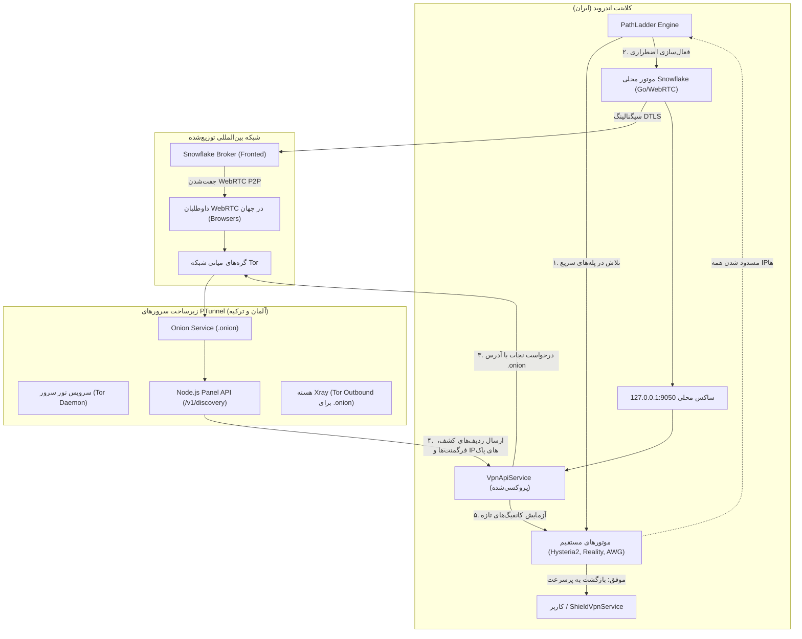

# طراحی ۰۰۰۲ — طناب نجات اضطراری، ترانسپورت‌های ضدسانسور مستقل (Snowflake/Tor) و همگام‌سازی تاب‌آور

- وضعیت: **تصمیم‌ها قفل شد (۲۰۲۶-۱۱-۲۲) — آمادهٔ پیاده‌سازی مرحله‌به‌مرحله**
- تاریخ: ۲۰۲۶-۱۱-۲۲
- سند مرجع تصمیم: [ADR-0008](../decisions/0008-emergency-lifeline-and-tor-resilience.md)
- اسناد مرتبط: [ADR-0005](../decisions/0005-client-core.md)، [ADR-0006](../decisions/0006-resilient-transports-and-anti-throttling.md)، [ADR-0007](../decisions/0007-client-auto-tuning-and-isp-presets.md)، [0001-network-discovery-and-split-tunnel.md](0001-network-discovery-and-split-tunnel.md)

---

## ۰) بیان دقیق مسئله و نیاز راهبردی

در معماری‌های مرسوم VPN ضد فیلترینگ، تمام اتصالات کلاینت متکی بر داشتن حداقل یک آدرس IP یا دامنه مستقیم به سرورهای خارجی (VPS در آلمان، ترکیه یا لبه‌های کلودفلر) است. در شرایط اعمال فیلترینگ سخت در ایران (مانند سناریوهای پاییز ۱۴۰۱، اینترنت سفید، یا بلک‌اوت بین‌الملل):
1. **مسدودسازی رنج‌های IP سرور:** رنج‌های دیتاسنتری Hetzner یا OVH بلافاصله Route-Null یا دچار پکت‌لاست ۱۰۰ درصدی می‌شوند.
2. **قفل شدن کانال کنترل و کشف (Control Plane Lockout):** هنگامی که ارتباط با سرور قطع است، کلاینت نه تنها ترافیک وب خود را از دست می‌دهد، بلکه نمی‌تواند با فراخوانی API سرور، نتایج کشف‌شده توسط سایر کاربران (مانند ردیف‌های اعتبارسنجیِ کشف شبکه در [طراحی ۰۰۰۱](0001-network-discovery-and-split-tunnel.md) یا فرگمنت‌های روز) را دریافت کند.
3. **شکست تور ساده (Vanilla Tor Failure):** اتصال مستقیم به شبکه تور در ایران کاملاً مسدود است و فعال‌سازی تور روی سرورهای خودمان نیز کمکی به اتصال اولیه کلاینت مسدودشده نمی‌کند.

**هدف این طراحی:** ایجاد یک مکانیزم نجات دومنظوره که بدون نیاز به هیچ آی‌پی ثابتی از سرورهای ما، کلاینت را ابتدا به عنوان یک **«بیکن اطلاعاتی (Rescue Beacon)»** به بک‌اند متصل کند تا آخرین مسیرهای خروج را بگیرد، و در صورت تداوم قطعی مطلق، به عنوان **«تونل اضطراری مستقل (Emergency Tunnel)»** ارتباط کاربر را حفظ نماید.

---

## ۱) نمای کلان معماری (System Architecture)



---

## ۲) مؤلفه‌های اصلی سیستم

### ۲.۱. مؤلفه کلاینت: موتور Snowflake محلی (Client Snowflake Core)
* **پروتکل ارتباطی:** WebRTC P2P با کدگذاری DTLS 1.2 / SRTP. این نوع ترافیک از دید سیستم‌های بازرسی عمیق بسته (DPI) اپراتورها کاملاً مشابه تماس تصویری یا صوتی وب است.
* **سازوکار اجرا:** به صورت یک ماژول بومی یا سرویس GoMobile سبک که فقط در صورت شکست تمام پله‌های عادی نردبان احضار می‌شود (`RecoveryStep.EMERGENCY_SNOWFLAKE`).
* **رابط داخلی:** باینری محلی یک SOCKS5 Listener روی `127.0.0.1:0` (پورت تصادفی داینامیک) باز می‌کند.
* **مدیریت مصرف باتری:** به محض بازیابی ارتباط مستقیم و پرسرعت، پروسس Snowflake فوراً متوقف (`SIGTERM`) می‌شود تا شارژ باتری مصرف نگردد.

### ۲.۲. مؤلفه سرور: سرویس پنهان آنین (Tor Hidden Service for Panel)
* **بدون ردپای IP:** روی هر دو سرور آلمان و ترکیه، دیمن سبک `tor` اجرا می‌شود.
* **کانفیگ `torrc`:**
  ```text
  HiddenServiceDir /var/lib/tor/ptunnel_api/
  HiddenServicePort 80 127.0.0.1:3000
  ```
* **نتیجه:** هر سرور یک آدرس پایدار مانند `http://ptu-germany-xxxxxx.onion` و `http://ptu-turkey-yyyyyy.onion` تولید می‌کند.
* **امنیت حداکثری:** ترافیک بین کلاینت و این آدرس درون شبکه چندلایه تور رمزگذاری می‌شود. فایروال مخابرات ایران حتی اگر سرور آلمان را ۱۰۰٪ مسدود کند، توانایی مسدودسازی این مسیر را ندارد چون مقصد بسته هیچ IP مشخصی نیست.

### ۲.۳. سازوکار دریافت نجات (Rescue Beacon Flow)
هنگامی که کلاینت روی SOCKS محلی Snowflake بالا می‌آید:
1. تابع `fetchResilientDiscovery()` در `VpnApiService`:
   ```kotlin
   val okHttpClient = OkHttpClient.Builder()
       .proxy(Proxy(Proxy.Type.SOCKS, InetSocketAddress("127.0.0.1", snowflakePort)))
       .callTimeout(Duration.ofSeconds(30))
       .build()
   ```
2. کلاینت آدرس مخفی سرور را فراخوانی می‌کند:
   `GET http://ptu-germany-xxxxxx.onion/v1/discovery/profile?operator=mci&network_key=...`
3. سرور پاسخ می‌دهد:
   * ردیف‌های کشف پایدار اخیر (`validated_rows`).
   * مقادیر تست‌شده فرگمنت، پورت‌های تازه Hysteria2 و IPهای تمیز CDN.
4. کلاینت کانفیگ‌های تازه را در حافظه جایگزین کرده و بلافاصله پروب می‌زند:
   * **اگر وصل شد:** تونل اصلی را روی کانفیگ پرسرعت جدید سوییچ می‌کند و Snowflake را خاموش می‌کند.
   * **اگر وصل نشد (بلک‌اوت کامل):** ترافیک کل سیستم از طریق همان تونل Snowflake به صورت Fallback عبور می‌کند تا کاربر در بی‌خبری نماند.

### ۲.۴. سوپاپ اطمینان برون‌باندی (Out-of-Band Dead Man's Mirror)
چنانچه حتی مسیر `.onion` با اختلال موقت مواجه شد، کلاینت از دو کانال زیر داده‌های بوت‌استرپ و نجات را دریافت می‌کند:
1. **رکوردهای DNS TXT کدگذاری‌شده (DoH):**
   * دامنه: `_ptu-rescue.ptu.beauty`
   * محتوا: رشته رمزنگاری‌شده با کلید عمومی اپلیکیشن حاوی آدرس‌های جدید و آی‌پی‌های نجات.
2. **کانال عمومی GitHub Raw:**
   * یک فایل کوچک `rescue.json.enc` در ریپازیتوری که در صورت هر تغییر بحرانی توسط سرور به طور خودکار بروزرسانی می‌شود.

---

## ۳) انتگرال‌گیری در هسته اندروید (`PathLadder.kt`)

ترتیب پله‌های نجات در بازیابی خودکار به شکل زیر به‌روزرسانی می‌شود:

```kotlin
enum class RecoveryStep {
    SAME_CONFIG,         // ۱. تلاش مجدد با کانفیگ فعلی
    OTHER_BOX,           // ۲. پرش به سرور دیگر (مثلاً ترکیه به آلمان)
    FRESH_MULTI,         // ۳. تلاش با پروتکل دیگر سرور فعلی (Hysteria2 / Reality / AWG)
    REALITY_ONLY,        // ۴. تست Reality با فرگمنت پویا
    CACHED_CDN,          // ۵. تست کلودفلر CDN با آی‌پی کش‌شده قبلی
    FRESH_CDN,           // ۶. تست کلودفلر CDN با اسکن سریع آی‌پی‌های تمیز
    EMERGENCY_SNOWFLAKE  // ۷. پله نجات اضطراری نهایی (Snowflake WebRTC + هماهنگی .onion)
}
```

---

## ۴) روتینگ خروجی تور در سمت سرور (Tor Outbound for .onion & Privacy)

علاوه بر طناب نجات ورودی، در فایل `xray.json.j2` سرور، خروجی به تور فعال می‌شود تا کاربران بتوانند از مزایای حریم خصوصی آن نیز استفاده کنند:
```json
{
  "outbounds": [
    {
      "protocol": "freedom",
      "tag": "direct"
    },
    {
      "protocol": "socks",
      "settings": {
        "servers": [{ "address": "127.0.0.1", "port": 9050 }]
      },
      "tag": "tor-out"
    }
  ],
  "routing": {
    "rules": [
      {
        "type": "field",
        "domain": ["domain:onion"],
        "outboundTag": "tor-out"
      }
    ]
  }
}
```

---

## ۵) نقشه راه پیاده‌سازی مرحله‌به‌مرحله (Implementation Roadmap)

| فاز | موضوع | اقلام قابل تحویل | بررسی صحت (Verification) |
| :--- | :--- | :--- | :--- |
| **گام ۱** | زیرساخت سرور و Hidden Service | راه‌اندازی دیمن Tor روی آلمان و ترکیه، تولید کلید ثابت `.onion`، اتصال به پورت ۳۰۰۰ پنل | `curl --socks5-hostname 127.0.0.1:9050 http://<onion>/v1/healthz` نتیجه ۲۰۰ دهد |
| **گام ۲** | روتینگ Xray به تور | افزودن outbound ساکس تور در کانفیگ سرور برای دامنه‌های `.onion` | تست باز شدن آدرس‌های `.onion` از طریق تونل کاربر |
| **گام ۳** | هسته Snowflake در کلاینت اندروید | ماژول کلاینت Snowflake در ریپوی اندروید و باز شدن لوکال پراکسی در پس‌زمینه | تست هندشیک با بروکرهای Snowflake و برقراری ساکس محلی |
| **گام ۴** | یکپارچه‌سازی نردبان و بازیابی | الحاق `RecoveryStep.EMERGENCY_SNOWFLAKE` به `PathLadder.kt` و اتصال `VpnApiService` | شبیه‌سازی قطعی کامل IPهای سرور و بالا آمدن موفق اتوماتیک |
