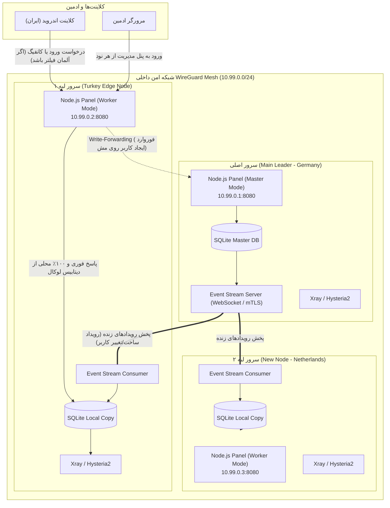

# طراحی ۰۰۰۳ — کلاستر توزیع‌شده سرورها، احراز هویت همه‌جایی (Read-Anywhere) و همگام‌سازی امن ضد DCSync

- وضعیت: **تصمیم‌ها قفل شد (۲۰۲۶-۱۱-۲۳) — آماده برای پیاده‌سازی گام‌به‌گام**
- تاریخ: ۲۰۲۶-۱۱-۲۳
- سند مرجع تصمیم: [ADR-0009](../decisions/0009-multi-node-cluster-and-anti-dcsync-replication.md)
- اسناد مرتبط: [ADR-0001](../decisions/0001-engine-and-panel.md)، [ADR-0005](../decisions/0005-client-core.md)، [ADR-0008](../decisions/0008-emergency-lifeline-and-tor-resilience.md)، [design/0002](0002-emergency-lifeline-and-pluggable-transports.md)

---

## ۰) نمای کلی مسئله و اهداف راهبردی

سیستم PTunnel نیازمند مدیریت یکپارچه ناوگانی از سرورهای مستقل در کشورهای گوناگون (آلمان به عنوان سرور اصلی/Main، ترکیه و نودهای آینده) است به گونه‌ای که:
1. **انعطاف و استقلال کامل کاربر (Zero Lockout):** اگر آی‌پی سرور اصلی در ایران فیلتر یا مسدود شد، کاربر بتواند به هر سرور دیگری در شبکه وصل شده، لاگین کرده و بدون مشکل کانفیگ و اشتراک خود را دریافت کند.
2. **مدیریت از هر نقطه (Global Admin):** پنل وب `/admin` روی تک‌تک سرورها فعال باشد و ادمین بتواند از هر سروری که در دسترس است کاربران را مدیریت کند.
3. **همگام‌سازی بلادرنگ حساب‌ها:** کاربران جدید و تغییرات ترافیک در کسری از ثانیه در سراسر کلاستر منعکس شوند.
4. **سد دفاعی ضد سرقت اطلاعات و حملات شبیه به DCSync:** تضمین عدم امکان الحاق سرورهای غیرمجاز و جلوگیری مطلق از تخلیه هش‌های پسورد کاربران.

---

## ۱) دیاگرام معماری کلاستر (Cluster Architecture)



---

## ۲) تشریح مؤلفه‌های اجرایی

### ۲.۱. خوانش محلی در همه نودها (Read-Anywhere Architecture)
* **دیتابیس مستقل روی هر سرور:** هر سرور فایل `ptunnel.db` محلی خود را دارد.
* **احراز هویت بدون وابستگی:** زمانی که کلاینت درخواست `POST /v1/auth/login` ارسال می‌کند:
  * وب‌سرور نود (مثلاً ترکیه) فیلدهای `username` و `password` را دریافت کرده و با هش `password_hash` موجود در SQLite محلی تطبیق می‌دهد.
  * هیچ استعلامی از سرور آلمان گرفته نمی‌شود (Latency = 0ms).
  * توکن JWT امضا شده و بازگردانده می‌شود.
* **اشتراک یکسان کلیدها:** از آنجا که `USER_JWT_SECRET` روی تمام سرورها یکسان است، توکنی که سرور ترکیه صادر کرده روی آلمان یا هلند نیز ۱۰۰٪ معتبر است.

### ۲.۲. پنل مدیریت همگانی و فوروارد تغییرات (Write-Forwarding)
* پنل وب `/admin` روی تمام سرورها اجرا می‌شود.
* متغیر محیطی `CLUSTER_ROLE`:
  * روی سرور اصلی: `CLUSTER_ROLE=leader`
  * روی نودهای ورکر: `CLUSTER_ROLE=follower` و `CLUSTER_LEADER_HOST=10.99.0.1:8080`
* **میان‌افزار فوروارد (Write-Forwarding Middleware):**
  هنگامی که یک درخواست تغییر (نظیر `POST /v1/admin/users` یا ویرایش وضعیت کاربر) به یک سرور فالوور برسد:
  ```javascript
  if (config.clusterRole === 'follower' && req.method !== 'GET') {
    // فوروارد درخواست به سرور لیدر از روی آی‌پی داخلی مش
    return forwardToLeader(req, res, config.clusterLeaderHost);
  }
  ```
* سرور لیدر تغییر را در دیتابیس ثبت کرده و پاسخ موفقیت‌آمیز به فالوور و نهایتاً به مرورگر ادمین بازمی‌گردد.

### ۲.۳. همگام‌سازی بلادرنگ رویدادمحور (Live Event Streaming)
برای اینکه تغییرات ایجاد شده در دیتابیس مرکزی در کمتر از ۱ ثانیه به تمام نودها برسد:
1. سرور لیدر یک کانال وب‌سوکت داخلی روی `ws://10.99.0.1:8080/internal/cluster/events` باز نگه می‌دارد.
2. نودهای فالوور همواره به این وب‌سوکت متصل هستند.
3. ساختار رویدادها:
   * `user.created`: حاوی رکورد کامل کاربر جدید.
   * `user.updated`: تغییر حجم، انقضا، یا فیلد `is_enabled`.
   * `user.deleted`: حذف کاربر از دیتابیس و هسته‌های پروکسی.
   * `preset.updated`: تغییر تنظیمات فرگمنت یا پورت‌های کشف‌شده.
4. نود فالوور به محض دریافت رویداد، دیتابیس محلی را به‌روزرسانی کرده و کاربر را فوراً در هسته Xray و Hysteria2 اضافه یا مسدود می‌کند.

### ۲.۴. تجمیع مصرف ترافیک (Bandwidth Delta Sync)
* هر سرور مصرف بایت کاربران خود را ثبت می‌کند (`local_delta_bytes`).
* هر ۳۰ ثانیه یک بار، نود فالوور یک پکت تجمیعی به لیدر ارسال می‌کند:
  ```json
  {
    "node_id": "srv_turkey",
    "deltas": [
      { "uid": "usr_7e6f1da5171f", "bytes": 104857600 }
    ]
  }
  ```
* لیدر مقدار را به `used_bytes` دیتابیس اضافه کرده و اگر حجم کاربر پایان یافته باشد، رویداد `user.updated (is_enabled=0)` را به تمام نودها مخابره می‌کند تا کاربر در کل کلاستر قطع شود.

---

## ۳) پروتکل امنیتی ضد سرقت دیتابیس (Anti-DCSync Defense)

برای خنثی‌سازی هرگونه نفوذ و جلوگیری از حملات تخلیه دیتابیس (مشابه DCSync):

| لایه دفاعی | سازوکار پیاده‌سازی | نتیجه امنیتی |
| :--- | :--- | :--- |
| **۱. ایزولاسیون شبکه** | ارتباط فقط از روی اینترفیس `wg-mesh` روی رنج `10.99.0.x` | پورت‌های سینک اصلاً از روی اینترنت عمومی قابل مشاهده نیستند. |
| **۲. احراز هویت متقابل (mTLS)** | کلید‌های جفت Ed25519 و سرتیفیکیت اختصاصی کلاستر | یک سرور ناشناس حتی در صورت نفوذ به رنج شبکه، در لایه هندشیک ریجکت می‌شود. |
| **۳. لیست سفید کلاستر** | جدول `cluster_nodes` با قفل کردن پابلیک‌کی و IP هر نود | هیچ سروری بدون ثبت اولیه در پایپلاین گیت‌هاب پذیرفته نمی‌شود. |
| **۴. پالایش هش پسوردها** | فالوورها به جدول `admins` و هش‌های مدیریتی نیاز ندارند | حتی با تصرف فیزیکی یک نود لبه، اطلاعات ادمین لو نمی‌رود. |

---

## ۴) ارتقای اضطراری به سرور اصلی (Emergency Leader Promotion)

اگر سرور اصلی (آلمان) به دلیل آتش‌سوزی در دیتاسنتر یا تحریم برای همیشه نابود شد:
1. ادمین وارد پنل `/admin` سرور سالم (مثلاً ترکیه) می‌شود.
2. به بخش **تنظیمات کلاستر (Cluster Settings)** می‌رود.
3. دکمه **«Promote Node to Leader»** را زده و رمز فوق‌امنیتی مستر کلاستر (`CLUSTER_MASTER_KEY`) را وارد می‌کند.
4. سرور ترکیه متغیر `CLUSTER_ROLE` خود را به `leader` تغییر داده و از این لحظه نقش مرکز کلاستر را بر عهده می‌گیرد؛ سایر نودها نیز به طور خودکار به ترکیه متصل می‌شوند.

---

## ۵) نقشه راه پیاده‌سازی

1. **فاز ۱ (شبکه مش WireGuard):** فعال‌سازی اینترفیس `wg-mesh` بین سرورهای آلمان و ترکیه (`10.99.0.1` و `10.99.0.2`).
2. **فاز ۲ (موتور Sync در Panel):** اضافه کردن اندپوینت رویدادمحور وب‌سوکت در `apps/panel` و کلاینت مصرف‌کننده فالوور.
3. **فاز ۳ (میان‌افزار Write-Forwarding):** هدایت خودکار متدهای غیر-GET ادمین از فالوورها به لیدر.
4. **فاز ۴ (تست Failover):** قطع آزمایشی اتصال سرور آلمان و راستی‌آزمایی لاگین و اتصال کلاینت از سرور ترکیه.
