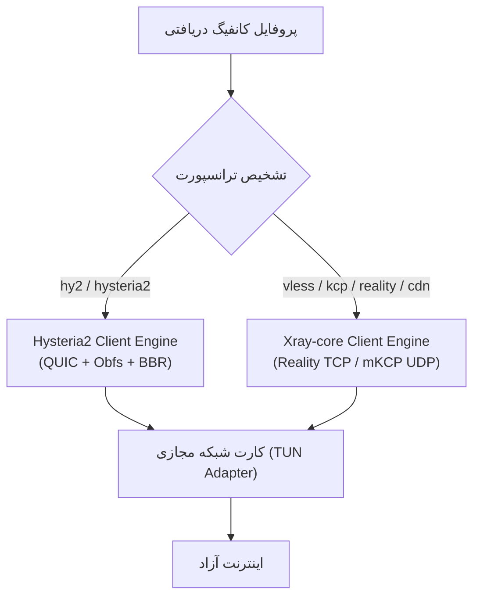

# معماری داخلی هسته کلاینت (PTunnel Agent Architecture)

این سند، مشخصات فنی و ساختار پکیج‌های ماژول Go هسته (`apps/agent`) را تعریف می‌کند. این هسته زیربنای مشترک نسخه اندروید و نسخه دسکتاپ (ویندوز و لینوکس) است.

---

## ۱. ساختار پوشه‌ها و پکیج‌های ماژول (`apps/agent`)

```
apps/agent/
├── go.mod
├── go.sum
├── cmd/
│   └── agent-desktop/        # باینری قابل اجرا برای دسکتاپ (ویندوز / لینوکس)
│       └── main.go
├── mobile/                   # بایندینگ Go-Mobile مخصوص اندروید
│   ├── bridge.go             # متدهای اکسپورت‌شده برای اندروید AAR
│   └── libv2ray_compat.go    # پل سازگاری با متدهای قبلی برای جلوگیری از کرش
└── pkg/
    ├── agent/                # ماشین حالت اصلی و هماهنگ‌کننده
    │   ├── agent.go          # اینترفیس و استراکچر اصلی Agent
    │   └── state.go          # وضعیت‌های هسته (Connecting, Connected, Lost, etc.)
    ├── engine/               # انجین‌های پروکسی (پوشش‌دهنده Xray و Hysteria2)
    │   ├── engine.go         # اینترفیس واحد موتور
    │   ├── xray_engine.go    # پیاده‌سازی اتصال به Xray-core
    │   └── hy2_engine.go     # پیاده‌سازی اتصال به Hysteria2 Client
    ├── tun/                  # آداپتورهای کارت شبکه پلتفرم‌ها
    │   ├── tun.go            # اینترفیس انتزاعی TUN
    │   ├── tun_android.go    # هندل کردن tunFd دریافتی از VpnService اندروید
    │   ├── tun_windows.go    # هندل کردن Wintun برای ویندوز
    │   └── tun_linux.go      # هندل کردن /dev/net/tun برای لینوکس
    ├── probe/                # موتور تست سرعت و پینگ فوق‌سریع
    │   ├── probe.go          # مسابقه پینگ موازی (Parallel TCP/UDP Race)
    │   └── health.go         # تست مستمر جریان اینترنت داخل تونل (/generate_204)
    └── stats/                # شمارنده بایت‌ها و آمار آپ‌تایم
        └── counter.go
```

---

## ۲. اینترفیس‌های کلیدی (Core Interfaces)

### ۲.۱. اینترفیس جامع هسته (`Agent`)
اینترفیس اصلی که کلاینت‌ها (سرویس اندروید یا واسط کاربری دسکتاپ) با آن ارتباط دارند:

```go
package agent

type CoreState string

const (
    StateDisconnected CoreState = "DISCONNECTED"
    StateConnecting   CoreState = "CONNECTING"
    StateConnected    CoreState = "CONNECTED"
    StateDegraded     CoreState = "DEGRADED"
    StateRecovering   CoreState = "RECOVERING"
)

type Stats struct {
    UplinkBytes   int64 `json:"uplinkBytes"`
    DownlinkBytes int64 `json:"downlinkBytes"`
    UptimeSeconds int64 `json:"uptimeSeconds"`
    LatencyMs     int64 `json:"latencyMs"`
}

type Agent interface {
    // استارت تونل با کانفیگ متنی JSON یا YAML و فایل‌دیسکریپتور کارت شبکه
    Start(config string, tunFd int) error
    
    // متوقف کردن تمیز تمام موتورها و بستن اینترفیس شبکه
    Stop() error
    
    // دریافت آمار زنده ترافیک و پینگ
    GetStats() Stats
    
    // سنجش تاخیر یک URL از درون تونل
    MeasureDelay(url string) (int64, error)
    
    // وضعیت فعلی
    CurrentState() CoreState
}
```

---

## ۳. مدیریت موتورها (Engine Management)

هسته بر اساس فیلد ترانسپورت داخل کانفیگ، موتور مناسب را فعال می‌کند:



* **Xray-core Integration:** از پکیج‌های رسمی `github.com/xtls/xray-core/core` برای لود مستقیم ساختار اینباند و اوتباند در حافظه استفاده می‌کند (بدون ساخت پروسه جانبی).
* **Hysteria2 Integration:** از کلاینت رسمی `github.com/apernet/hysteria/core/v2/client` بهره می‌برد و پکت‌های UDP و TCP خوانده‌شده از TUN را با کانکشن رمزنگاری‌شده QUIC به سرور پمپ می‌کند.

---

## ۴. چرخهٔ ساخت و خروجی برای پلتفرم‌ها (Build Pipelines)

### ۴.۱. اندروید (تولید AAR)
با ابزار `gomobile`، پکیج `mobile` مستقیماً به یک کتابخانه Java/Kotlin به نام `libptunnel.aar` کامپایل می‌شود:
```bash
gomobile bind -target=android/arm64,android/arm,android/amd64 \
  -o apps/android/app/libs/libptunnel.aar \
  ./apps/agent/mobile
```
این خروجی بدون نیاز به هیچ تغییر ساختاری در UI اندروید، در `apps/android/app/build.gradle.kts` جایگزین `libv2ray.aar` می‌شود.

### ۴.۲. ویندوز (Desktop Binary)
به صورت کاملاً Static و مستقل از هرگونه DLL خارجی:
```powershell
$env:GOOS="windows"; $env:GOARCH="amd64"
go build -ldflags="-s -w" -o ptunnel-desktop.exe ./apps/agent/cmd/agent-desktop
```
همراه با فایل کم‌حجم `wintun.dll` (درایور رسمی و امضاشده توسط WireGuard) در کنار فایل اجرایی اجرا می‌شود.
