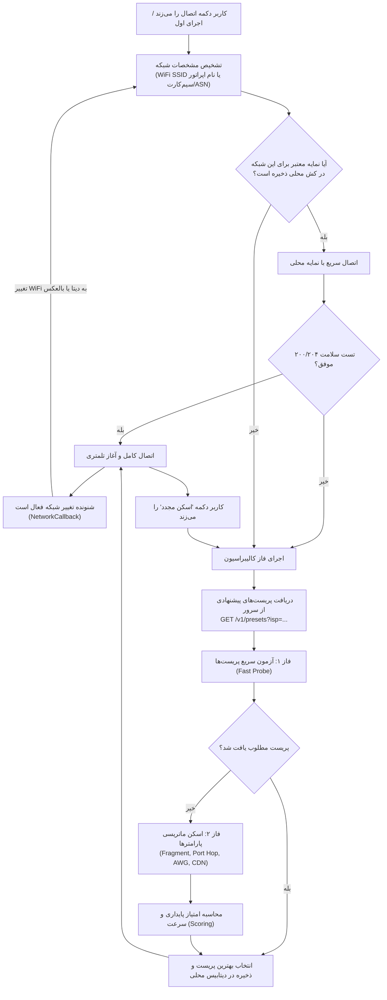

# مشخصات فنی سیستم کالیبراسیون و تنظیم خودکار کلاینت (Client Auto-Tuning Spec)

این سند مرجع جامع فنی برای پیاده‌سازی سیستم تنظیم خودکار، دیتابیس پریست‌های اپراتوری و موتور اسکن اکتشافی در کلاینت‌های PTunnel (اندروید، دسکتاپ و Go Agent) است.

---

## ۱. چرخه حیات و معماری جریان کار (Lifecycle Flow)



---

## ۲. ساختار قرارداد API سرور برای پریست‌ها (`/v1/presets`)

سرور تنظیمات بهینه را بر اساس تله‌متری خطوط و به‌روزرسانی‌های مدیران شبکه در پایگاه داده نگهداری کرده و به تفکیک اپراتور تحویل می‌دهد.

### ۲.۱. درخواست
```http
GET /v1/presets?isp=mci&network_type=cellular HTTP/1.1
Host: api.ptunnel.net
Authorization: Bearer <token>
```
* پارامترهای اختیاری: `isp` (شناسه‌های استاندارد: `mci`, `irancell`, `rightel`, `shatel`, `mokhaberat`, `zitel`, `unknown`) و `network_type` (`wifi`, `cellular`).

### ۲.۲. پاسخ نمونه
```json
{
  "isp": "mci",
  "generated_at": "2026-11-15T15:00:00Z",
  "version": 4,
  "candidates": [
    {
      "priority": 1,
      "engine": "hysteria",
      "transport": "hy2",
      "config": {
        "ports": "20000-50000",
        "primary_port": 443,
        "hop_interval_seconds": 45,
        "mtu": 1280,
        "obfs": "salamander"
      }
    },
    {
      "priority": 2,
      "engine": "xray",
      "transport": "reality",
      "config": {
        "port": 8080,
        "sni": "www.microsoft.com",
        "fingerprint": "chrome",
        "fragment": {
          "enabled": true,
          "packets": "1-3",
          "length": "100-200",
          "interval": "10-20"
        }
      }
    },
    {
      "priority": 3,
      "engine": "awg",
      "transport": "wireguard_obfs",
      "config": {
        "port": 51820,
        "jc": 5,
        "jmin": 40,
        "jmax": 70,
        "s1": 65,
        "s2": 92
      }
    },
    {
      "priority": 4,
      "engine": "xray",
      "transport": "cdn_ws",
      "config": {
        "clean_ips": ["188.114.96.3", "188.114.97.3", "104.17.2.81"],
        "port": 2083,
        "path": "/ws"
      }
    }
  ]
}
```

---

## ۳. تحلیل متغیر بودن پارامترها بر حسب اپراتورهای ایران

### چرا یک تنظیم ثابت برای همه کار نمی‌کند؟
1. **تفاوت در سخت‌افزار DPI:**  
   اپراتور همراه اول (MCI) و ایرانسل از تجهیزات DPI متفاوتی در گیت‌وی‌های خروجی استفاده می‌کنند. یکی از تجهیزات ممکن است حافظه کش بالایی برای بازسازی پکت‌های TCP داشته باشد و بسته‌های ریز `10-30` بایتی را تا ۳۰ ثانیه معطل نگه دارد؛ بنابراین فرگمنت بسیار ریز روی آن خط اتصال را فریز می‌کند. در مقابل، تجهیزات دیگری با رسیدن بسته با طول کمتر از ۵۰ بایت، تایم‌اوت داده و اجازه عبور می‌دهند.
2. **سیاست تراتلینگ UDP و بازه پورت:**  
   مخابرات و شاتل معمولاً حساسیت کمتری به پروتکل‌های UDP دارند و پورت ثابت ۴۴۳ روی آن‌ها بدون هاپینگ عالی کار می‌کند. اما اینترنت موبایل (همراه اول و ایرانسل) روی ترافیک سنگین UDP پس از چند دقیقه پکت‌لاست مصنوعی تزریق می‌کنند و Port Hopping برای بقای آن‌ها حیاتی است.
3. **محدودیت‌های اندازه MTU در شبکه موبایل:**  
   در شبکه‌های 4G/5G همراه اول به دلیل روت‌های داخلی و کپسوله‌سازی GTP، مقدار Path MTU واقعی معمولاً بین ۱۲۸۰ تا ۱۳۶۰ است. بسته‌های بزرگتر در لایه رادیویی تکه‌تکه شده و پکت‌لاست را به شدت بالا می‌برند؛ بنابراین کلاینت باید در اسکن خودکار MTU بهینه را برای هر خط کشف کند.

### جدول پریست‌های پایه تجربی برای اپراتورهای ایران

| اپراتور | اولویت موتور اول | تنظیم بهینه Fragment (طول / تاخیر) | پورت هاپینگ Hysteria | مقدار MTU پیشنهادی |
| :--- | :--- | :--- | :--- | :--- |
| **همراه اول (MCI)** | Hysteria 2 (با پورت هاپینگ ۴۵s) | `length: 100-200` / `interval: 10-20ms` | فعال (بازه ۲۰۰۰۰-۵۰۰۰۰) | ۱۲۸۰ |
| **ایرانسل (Irancell)** | Hysteria 2 یا Reality | `length: 10-50` / `interval: 5-10ms` | فعال (بازه ۲۰۰۰۰-۵۰۰۰۰) | ۱۲۸۰ |
| **مخابرات (TCI / ADSL)** | Xray Reality + Fragment | `length: 50-150` / `interval: 10-15ms` | اختیاری (پورت ۴۴۳ ثابت) | ۱۴۲۰ |
| **شاتل (Shatel)** | Hysteria 2 یا Reality | `length: 100-200` / `interval: 15-25ms` | فعال (پورت هاپینگ ۶۰s) | ۱۳۵۰ |
| **رایتل (RighTel)** | AmneziaWG یا Reality | `length: 20-80` / `interval: 10-20ms` | فعال (بازه ۳۰۰۰۰-۵۰۰۰۰) | ۱۲۸۰ |

---

## ۴. موتور اسکن و الگوریتم امتیازدهی در کلاینت (Benchmark & Auto-Scan)

کلاینت تست‌ها را به صورت چندمرحله‌ای اجرا می‌کند تا کاربر زمان زیادی معطل نماند:

### مرحله ۱: پروب‌های سریع هم‌زمان (Concurrent Fast Probes)
کلاینت پریست‌های تحویل‌شده از سرور را به صورت هم‌زمان تست می‌کند:
- ارسال درخواست سبک به یک اندپوینت فوق‌سریع (مانند `https://www.google.com/generate_204` یا اندپوینت پینگ `/s` سرور).
- ضبط زمان برقراری هندشیک (`Handshake Latency`) و نرخ خطا.
- هر نمایه‌ای که زیر ۴۰۰ میلی‌ثانیه پاسخ معتبر ۲۰۰ یا ۲۰۴ بدهد، بلافاصله اتصال اصلی را برقرار می‌کند.

### مرحله ۲: اسکن ماتریسی در صورت شکست پریست‌ها (Matrix Grid Search)
اگر تمام پریست‌های پیشنهادی با شکست مواجه شدند:
- **اسکن فرگمنت:** کلاینت ۳ بازه استاندارد را روی کانفیگ Reality تست می‌کند:
  1. `[10-50, 5-10]` (ریز و تهاجمی)
  2. `[100-200, 10-20]` (استاندارد و متعادل)
  3. `[300-600, 1-5]` (ملایم برای خطوط خانگی)
- **اسکن پورت UDP هیستریا:** بررسی پورت‌های ۴۴۳، ۸۴۴۳، ۲۰۵۳ و یک پورت تصادفی در بازه ۲۵۰۰۰.
- **اسکن آی‌پی تمیز CDN:** تست تاخیر ۵ آی‌پی تمیز کلاودفلر و انتخاب بهترین نمونه.

### تابع امتیازدهی (Scoring Function)
امتیاز نهایی هر پیکربندی طبق فرمول زیر محاسبه می‌شود:
$$\text{Score} = \frac{1000}{\text{Latency (ms)}} \times \text{Success Rate} \times \text{Throughput Weight}$$
پیکربندی با بالاترین امتیاز در پایگاه داده محلی کلاینت (`Local SQLite / Room`) برای آن شبکه ذخیره می‌شود.

---

## ۵. ردیابی تغییر وضعیت شبکه در اندروید (Network Switch Detection)

کلاینت نباید منتظر قطعی بماند؛ با سوییچ بین شبکه‌ها، وضعیت به صورت بی‌درنگ مدیریت می‌شود:

```kotlin
// نمونه پیاده‌سازی ثبت شنونده در سرویس کلاینت
val connectivityManager = getSystemService(Context.CONNECTIVITY_SERVICE) as ConnectivityManager
val networkRequest = NetworkRequest.Builder()
    .addCapability(NetworkCapabilities.NET_CAPABILITY_INTERNET)
    .build()

connectivityManager.registerNetworkCallback(networkRequest, object : ConnectivityManager.NetworkCallback() {
    override fun onCapabilitiesChanged(network: Network, capabilities: NetworkCapabilities) {
        val currentNetworkKey = resolveNetworkFingerprint(capabilities)
        if (currentNetworkKey != activeNetworkKey) {
            Log.i("PTunnel", "Network changed from $activeNetworkKey to $currentNetworkKey")
            activeNetworkKey = currentNetworkKey
            // بارگذاری سریع بهترین نمایه ذخیره‌شده این شبکه یا اجرای کالیبراسیون
            applyBestProfileForNetwork(currentNetworkKey)
        }
    }
})
```

* **Network Fingerprint:** شامل ترکیبی از نوع شبکه (`WIFI` یا `CELLULAR`)، نام SSID وای‌فای (در صورت داشتن مجوز) یا ترکیب کد اپراتور (مانند `43211` برای همراه اول و `43235` برای ایرانسل).

---

## ۶. طراحی رابط کاربری (UI/UX Specification)

1. **ویزارد کالیبراسیون در اولین اجرا (First-Run Calibration Onboarding):**
   * هنگام اولین اتصال، یک دیالوگ زیبا با انیمیشن پیشرفت به کاربر نشان داده می‌شود:
     * *«در حال آنالیز وضعیت شبکه و تست بهترین راهکارهای اتصال برای خط شما...»*
     * نمایش وضعیت تست هر موتور (Xray Reality ✅، Hysteria 2 ✅، AmneziaWG ⏳).
   * پس از ۴ تا ۸ ثانیه، بهترین اتصال با کمترین پینگ انتخاب و پیام *«بهترین مسیر برای خط همراه اول شما انتخاب شد»* نمایش داده می‌شود.

2. **دکمه و کارت اسکن مجدد در صفحه اصلی (Rescan Button):**
   * در صفحه اصلی، یک دکمه یا کارت با عنوان **«بهینه‌سازی و اسکن مجدد شبکه» (Optimize Connection)** تعبیه شده است.
   * هر زمان کاربر احساس کند سرعت افت کرده، یا سیم‌کارتش را تغییر داده است، با زدن این دکمه کلاینت اسکن را تکرار کرده و تنظیمات را مجدداً برای شرایط جدید کالیبره می‌کند.

3. **کارت وضعیت و تله‌متری زنده (Diagnostics Card):**
   * نمایش نام پروتکل فعال، پورت انتخابی، وضعیت فرگمنت و پینگ زنده به کاربر تا همواره از کیفیت اتصال مطلع باشد.
