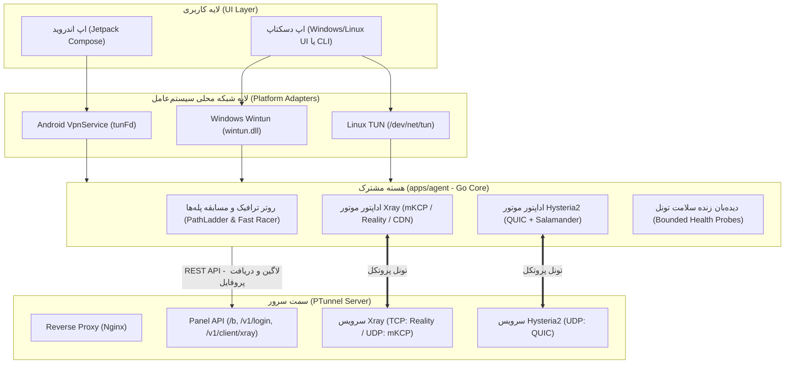

# راهنمای هماهنگی کلاینت (موبایل و PC) با سرور — PTunnel Client Coordination

این سند، مرجع جامع فنی برای پیاده‌سازی و هماهنگی هسته کلاینت (**اندروید، ویندوز و لینوکس**) با سرور PTunnel است.
**اصل اساسی:** یک منطق مرکزی در هسته مشترک (Core Agent)، با پوسته‌های مجزای پلتفرمی برای رابط شبکه و UI.

---

## ۱. نقشه کلی ارتباطات (Architecture Overview)



---

## ۲. چرخه حیات اتصال کلاینت (Connection Lifecycle)

تمام پلتفرم‌ها (موبایل و دسکتاپ) دقیقاً از یک چرخه حیات و ماشین حالت تبعیت می‌کنند:

```
[قطع: DISCONNECTED]
        |
        v  (کاربر دکمه Connect را می‌زند)
[در حال اتصال: CONNECTING]
        |  --> ۱. دریافت آدرس سرور زنده از Bootstrap (در صورت لزوم)
        |  --> ۲. ارسال توکن لاگین و دریافت پروفایل ترانسپورت (/v1/client/xray)
        |  --> ۳. بالا آوردن رابط کارت شبکه TUN
        |  --> ۴. استارت موتور انتخابی (Hysteria2 یا Xray)
        |  --> ۵. پروب تایید اتصال واقعی از درون تونل (تست /generate_204 با مهلت زمانی)
        |
        +-----> [متصل و پایدار: CONNECTED]
                    |
                    | (اگر ۳ تست متوالی تایم‌اوت خورد یا پکت‌لاس بالا رفت)
                    v
            [کاهش کیفیت یا قطعی: DEGRADED / LOST]
                    |
                    v
            [ریکاوری هوشمند: RECOVERING]
                    |  --> پله ۱: همان کانفیگ دوباره دیال شود (رفع قطعی لحظه‌ای رادیو)
                    |  --> پله ۲: تست هم‌زمان باکسی دیگر (OTHER_BOX)
                    |  --> پله ۳: سوئیچ به پروتکل دیگر (مثلاً از Hysteria2 به mKCP یا Reality)
                    |  --> پله ۴: سوئیچ به مسیر امن CDN (Cloudflare WebSocket)
                    |
                    +-----> (تست موفق) -----> برگشت به [CONNECTED]
```

---

## ۳. تفاوت‌های پیاده‌سازی بر اساس پلتفرم (Platform Adapters)

تمام پردازش‌های پروکسی، رمزنگاری و سوئیچ بین پروتکل‌ها درون کد Go هسته انجام می‌شود. تنها تفاوت در **«نحوه دریافت پکت‌های IP از سیستم‌عامل»** است:

| ویژگی | اندروید (Android) | ویندوز (Windows) | لینوکس (Linux) |
| :--- | :--- | :--- | :--- |
| **ایجاد کارت شبکه (TUN)** | از طریق متد `VpnService.Builder().establish()` که یک File Descriptor به نام `tunFd` تحویل می‌دهد. | استفاده از درایور رسمی و فوق‌سریع **Wintun** (`wintun.dll`). | باز کردن دیوایس سیستم‌عامل `/dev/net/tun` با دستور `ioctl(TUNSETIFF)`. |
| **مسیردهی جدول روت (Routing)** | اندروید خودش با دادن `addRoute("0.0.0.0", 0)` تمام ترافیک را به سمت تونل هدایت می‌کند. | هسته کلاینت از طریق Windows IP Helper API مسیر پیش‌فرض (`0.0.0.0/0`) را روی Wintun با متریک پایین‌تر تنظیم می‌کند. | اضافه کردن روت با `ip route add default dev tun0`. |
| **استثنا کردن سرور (Bypass IP)** | اندروید به واسطه متد `protect(socket)` یا `addDisallowedApplication(packageName)` سوکت‌های خود اپ را از تونل بیرون نگه می‌دارد تا لوپ نخورد. | اضافه کردن روت استاتیک با اولویت بالا برای آی‌پی سرور PTunnel به سمت گیت‌وی اصلی اینترنت (کارت شبکه فیزیکی). | افزودن روت استاتیک آی‌پی سرور از طریق اینترفیس فیزیکی (`ip route add <server_ip> via <gw>`). |
| **شکل خروجی هسته** | کتابخانه نیتیو اندروید: **`libptunnel.aar`** (تولید با `gomobile bind`). | یک فایل اجرایی یا سرویس پس‌زمینه: **`ptunnel-agent.exe`**. | باینری مستقل دسکتاپ یا سرویس systemd: **`ptunnel-agent`**. |

---

## ۴. قرارداد ارتباطی با سرور (Server Interaction)

### ۴.۱. مکانیزم عبور از سد فیلترینگ برای احراز هویت (Anti-Censorship Bootstrap)
یکی از مشکلات اصلی کاربران این بود که در زمان قطعی شدید، حتی صفحه لاگین باز نمی‌شد. کلاینت برای رسیدن به سرور این نردبان را طی می‌کند:
1. **آدرس مستقیم دامنه‌ها:** تست موازی دامنه‌های اصلی و ساب‌دامنه‌های پین‌شده.
2. **پشتیبان کلودفلر (CDN Mirror):** آدرس پروکسی‌شده روی CDN با آی‌پی‌های تمیز.
3. **دیکد رکورد DNS TXT:** خواندن رکورد `_ptu-bootstrap` از سرورهای DoH معتبر (مانند 1.1.1.1) برای دریافت آی‌پی‌های بدون فیلتر جدید سرور بدون نیاز به آپدیت اپ.

### ۴.۲. دریافت کانفیگ بر اساس تگ ترانسپورت (`GET /v1/client/xray?tag=<tag>`)
سرور بر اساس تگ ارسالی، کانفیگ اختصاصی تولید می‌کند:
* `tag=multi`: شامل پروتکل‌های چرخشی (اولویت با mKCP و Hysteria2، همراه با Reality به عنوان بک‌آپ).
* `tag=hy2`: کانفیگ مستقیم Hysteria2 با پورت‌هاپینگ (Port Hopping) و مبهم‌سازی Salamander.
* `tag=reality`: کانفیگ VLESS + XTLS-Reality برای زمان‌هایی که UDP فیلتر است.
* `tag=cdn`: کانفیگ از طریق وب‌سوکت CDN برای شرایط بحرانی فیلترینگ سراسری.

### ۴.۳. همگام‌سازی مصرف ترافیک و سهمیه (`POST /v1/user/traffic-sync`)
کلاینت هر ۲ دقیقه یک‌بار یا در زمان قطع اتصال، بایت‌های مصرف‌شده در نشست را به سرور می‌فرستد:
```json
{
  "uid": "usr_99281",
  "consumedSessionBytes": 10485760,
  "totalUsedBytes": 524288000,
  "activeNodeHost": "de.ptunnel.net",
  "activeNodePort": 443
}
```

### ۴.۴. گزارش سلامت خطوط از سمت کلاینت‌ها (`POST /internal/reachability`)
کلاینت پس از تست موفق یا ناموفق، وضعیت ۳ رقم اول آی‌پی کاربر (مثلاً `37.156.12.x` برای حفظ حریم خصوصی) را به سرور گزارش می‌دهد:
```json
{
  "network": "37.156.12",
  "verdict": "ok | tunnel_failed | server_unreachable",
  "port": 8443,
  "box": "de-1"
}
```
این گزارش به پنل سرور اجازه می‌دهد بداند کدام اپراتور با کدام پروتکل بهترین کارایی را دارد.

---

## ۵. تست‌های تضمین کیفیت هماهنگی (Acceptance Criteria)

هر نسخه از هسته کلاینت (چه روی اندروید چه ویندوز) باید ۳ تست پذیرش زیر را با موفقیت پاس کند:
1. **تست باز شدن کپتیو گوگل:** دریافت کد `204` از `https://www.google.com/generate_204`.
2. **تست دور زدن تحریم از سرور:** دریافت کد `200` از `https://gemini.google.com/app`.
3. **تست دانلود ضد خفگی:** دانلود یک فایل تست ۸ مگابایتی در چانک‌های ۵۱۲ کیلوبایتی با سرعت میانگین بیش از ۵۰۰ کیلوبایت بر ثانیه روی خطوط ایرانی.
